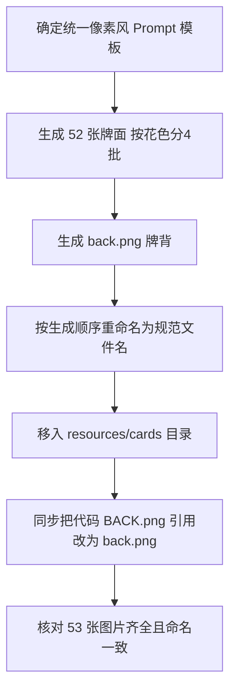

## 产品概述

为 Java 21 点（BlackJack）游戏生成一套原创像素风扑克牌图片资源，替代下载现成素材，供 Swing 界面直接加载显示。

## 核心功能

- 生成 52 张牌面图片：点数 A~K 乘以 4 种花色（C 梅花、D 方块、H 红桃、S 黑桃）
- 生成 1 张牌背图片 back.png（小写），用于庄家未结算时的暗牌
- 统一 8-bit 像素复古风格；红桃与方块用红色系，黑桃与梅花用黑色系
- 牌面点数文字由 AI 直接绘制（用户已知 AI 可能绘制不准并接受此效果）
- 按规范命名并保存到项目资源目录；同步把代码里牌背引用由大写 BACK.png 改为小写 back.png，保证大小写匹配

## 技术栈选择

- **AI 图像生成**：使用「多模态内容生成」技能的 `buddy-cloud.py image` 命令（或 `image_gen` 工具经 DeferExecuteTool 调用）
- **图片格式**：PNG；尺寸 640x960（2:3 竖版，与界面 cardWidth=100、cardHeight=150 比例一致，且 640x960=614400 小于 1048576 的面积上限）
- **资源目录**：`d:/新建文件夹/BlackJack/src/main/resources/cards/`（Maven 标准资源路径；代码中 `getClass().getResource("/cards/xxx.png")` 从此读取，已通过源码核对）

## 实现方案

- **统一 Prompt 模板**：固定基础风格描述，仅替换点数、花色名称、花色符号、颜色四个变量，保证 53 张风格一致
- **逐张生成**：每张牌单独调用生成并在 prompt 中明确写出该张的点数与花色，避免一次生成多张导致内容混乱
- **即时命名**：生成工具自动保存的文件名不可控，需生成后立即重命名为规范文件名（如先输出到临时目录，再按生成顺序统一改名并移入 cards 目录）
- **分批执行**：按花色分 4 批（每批 13 张）加牌背 1 张，降低单次失败的影响范围
- **代码同步修改**：把 BlackJack.java 第 80 行 `getResource("/cards/BACK.png")` 改为 `getResource("/cards/back.png")`，第 92 行绘制文字 "BACK" 可保留不影响功能

## 实现注意事项

- **Prompt 模板（牌面）**：Pixel art style, retro 8-bit playing card, chunky pixels, limited color palette, white background, simple bold border, card rank {点数} of {花色名} {符号}, large {符号} symbol in center, rank {点数} text in top-left corner, {red/black} color, flat 2D pixel game asset, crisp edges
- **Prompt 模板（牌背）**：Pixel art style, retro 8-bit playing card back, chunky pixels, limited color palette, blue and white geometric pattern, symmetric design, simple bold border, flat 2D pixel game asset
- **花色映射**：C 梅花 clubs 黑色、D 方块 diamonds 红色、H 红桃 hearts 红色、S 黑桃 spades 黑色；文件名格式 点数-花色.png，例如 A-C.png、10-H.png
- **牌背命名**：统一使用小写 back.png；Java getResource 大小写敏感，必须同时改代码引用，否则打包后找不到图片
- **Token 管理**：若使用技能脚本，每次生成前必须重新调用 connect_cloud_service 获取临时密钥，禁止复用旧凭证，且不向用户暴露
- **失败处理**：生成失败必须明确报错，不得编造图片；单张失败可重试该张，不影响其他已生成图片
- **验证**：生成后用文件列表核对 53 个文件齐全、命名无误、均为有效 PNG；代码引用与文件名一致
- **范围控制**：当前 BlackJack.java 存在编译错误（第 50 行多余括号、第 74 行 drawString 参数类型、第 253 行 Crad 拼写），图片生成后若要实际运行验证需另案修复，不在本次范围（牌背命名这一处小改除外）

## 架构设计



## 目录结构

```
d:/新建文件夹/BlackJack/src/main/resources/cards/
├── A-C.png ~ K-C.png    # [NEW] 梅花 13 张，黑色
├── A-D.png ~ K-D.png    # [NEW] 方块 13 张，红色
├── A-H.png ~ K-H.png    # [NEW] 红桃 13 张，红色
├── A-S.png ~ K-S.png    # [NEW] 黑桃 13 张，黑色
└── back.png             # [NEW] 牌背 1 张，暗牌显示（小写）
```

代码修改：

```
src/main/java/chen/BlackJack.java
- 第80行 getResource("/cards/BACK.png") → getResource("/cards/back.png")
```

## Agent Extensions

### Skill

- **多模态内容生成**
- Purpose：通过 AI 文生图能力逐张生成像素风扑克牌图片，控制点数、花色、颜色与统一风格。
- Expected outcome：在 `src/main/resources/cards/` 得到 53 张命名规范、风格一致的 PNG 图片，并同步修正代码里的牌背引用。